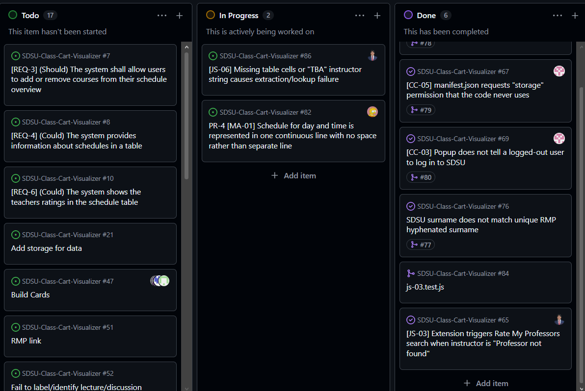

# PR4 Team Report

Team 14: Carissa Chen, Julian Vasquez, Mehla Abebe, Zachary Soriano

## 1. Bug Triage Table

| Test name | Bucket | Issue link | Severity | Priority | Owner | Status |
|---|---|---|---|---|---|---|
| ZS-06: Hyphenated surname lookup | Code bug | #76 | Medium | Medium | Zachary Soriano | Fixed |
| ZS-03: Ambiguous professor matches | Code bug | #64 | High | High | Zachary Soriano | Fixed|
| JS-03: No professor name matches | Code bug | #65 | Medium | Medium | Julian | Fixed|
| JS-06: Missing table cells throw TypeError | Code bug | #86 | Medium | Medium | Julian Saquic | Fixed |
| Edge-Case-Test1: Location formatting trailing| code bug | #83| Low| Low | Mehla Abebe| Fixed|
| Edge-Case-Test2: Day and Time  formatting trailing| code bug | #82| Low| Low | Mehla Abebe| Fixed|

## 2. Regression Log

- November 21, 2026: Hyphenated-surname fix checked.
- November 22, 2026: Ambiguous-match fix checked.
- November 22, 2026: No-Match fix checked.
- November 23, 2026: Location, date and time formatting fix broke Test JS-06

## 3. Final Test Run

## 4. Feature Decision

- **GitHub Issue:** https://github.com/preipolska3398-code/SDSU-Class-Cart-Visualizer/issues/88
- **User Story:** I want to detect overlapping days and meeting times between courses in my shopping cart and my currently enrolled classes so that I can avoid time conflicts before attempting to enroll.
- **Rationale:** Currently, `content.js` extracts raw `course.schedule` strings and `popup.js` renders them as plain text without comparing meeting times against a student's currently enrolled schedule. Detecting day/time overlaps prevents registration errors on my.SDSU and helps students choose conflict-free sections while checking Rate My Professors ratings.
- **Planned Ownership:**
  - **Enrolled Schedule Scraping (`content.js`):** Julian Saquic
  - **Time-Range Parsing & Conflict Logic (`scheduleConflict.js`):** Zachary Soriano
  - **Popup Conflict Warning UI (`popup.js`, `style.css`):** Mehla Abebe
  - **Edge-Case Messaging & Regression Tests (`popupMessages.js`, `tests/`):** Carissa Chen
- ## Acceptance Test Cases
1. **TC-FEAT-01:** A student is enrolled in `CS 370 (MW 2:00PM - 3:15PM)` and has `CS 450 (MW 2:30PM - 3:45PM)` in their shopping cart. Open the popup. **Expected:** The popup displays a clear time-conflict warning on the `CS 450` card indicating that it overlaps with `CS 370 (MW 2:00PM - 3:15PM)`.
2. **TC-FEAT-02:** A student is enrolled in `CS 370 (MW 2:00PM - 3:15PM)` and has `CS 460 (TTh 2:00PM - 3:15PM)` and `CS 490 (TBA)` in their shopping cart. Open the popup. **Expected:** Neither `CS 460` nor `CS 490` displays a false conflict warning, and no errors are thrown.

## 5. Board Snapshot

## 6. Sprint Summary

In PR4, We as a team fixed issues that were found in the last sprint. All fixes were reviewed by teammates, and merged into `main`, leaving the codebase stable for implementing schedule time-conflict detection against currently enrolled classes next sprint.
