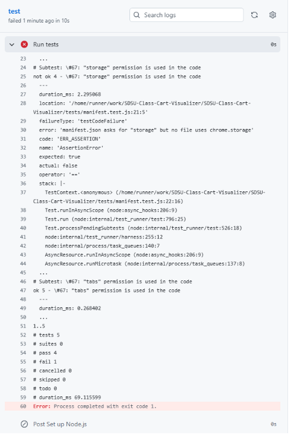
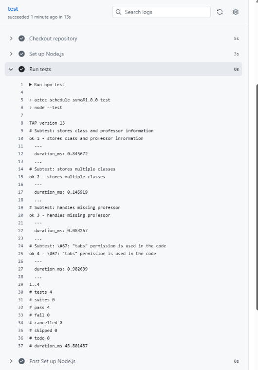
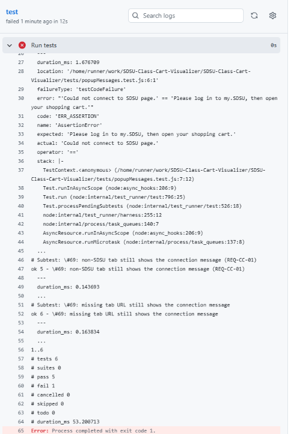
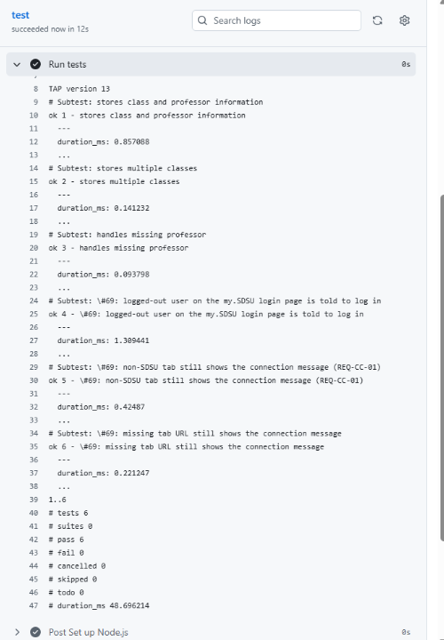

# Carissa Chen

## Bug Fix 1: Issue #67, unused "storage" permission

- **Issue:** https://github.com/preipolska3398-code/SDSU-Class-Cart-Visualizer/issues/67
- **PR:** https://github.com/preipolska3398-code/SDSU-Class-Cart-Visualizer/pull/79

**Before** (tests/manifest.test.js fails):

**After** (all tests pass):

**Bucket:** Code bug. The test was correct because no file uses chrome.storage, so manifest.json was asking for a permission the extension never uses; removing it made the test pass without breaking any other test.

## Bug Fix 2: Issue #69, logged-out user not told to log in

- **Issue:** https://github.com/preipolska3398-code/SDSU-Class-Cart-Visualizer/issues/69
- **PR:** https://github.com/preipolska3398-code/SDSU-Class-Cart-Visualizer/pull/80

**Before** (tests/popupMessages.test.js fails):

**After** (all tests pass):

**Bucket:** Code bug. The popup already handled this case but showed the wrong message ("Could not connect to SDSU page.") on the my.SDSU login page, which I confirmed by signing out and testing it in PR3 (CC-03); the test was correct, so I changed the code.

## AI Disclosure

I used Claude to format this file.
