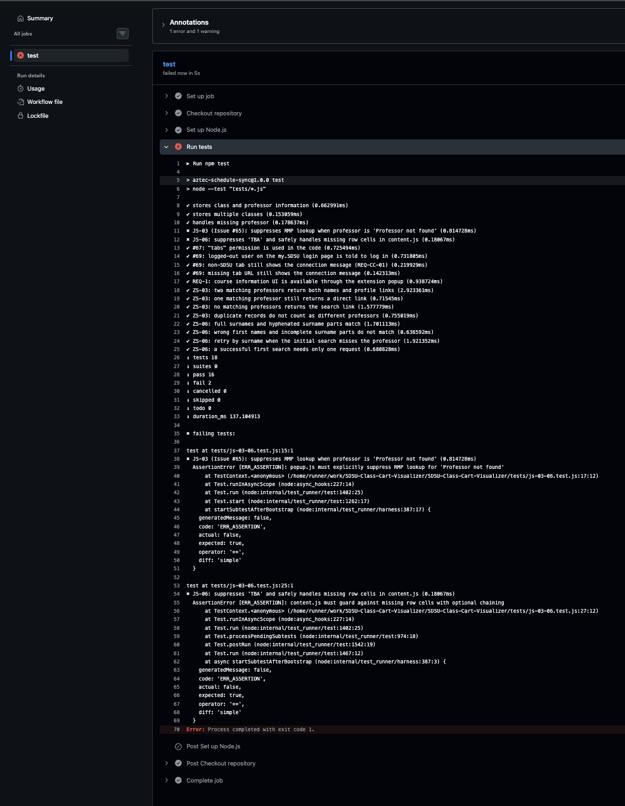
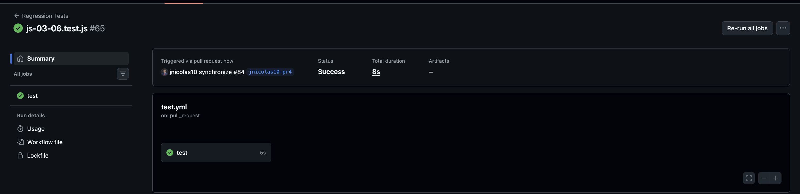
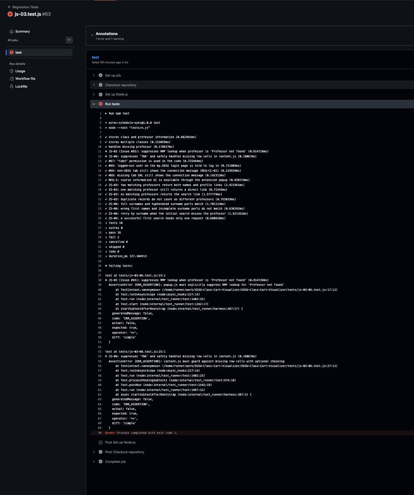
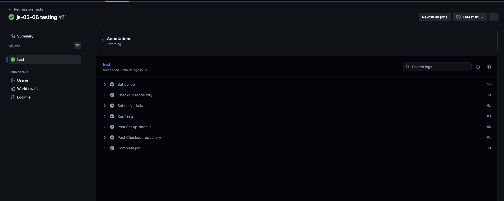

# Julian Saquic

## Bug Fix 1: Issue #65

- **Issue:** https://github.com/preipolska3398-code/SDSU-Class-Cart-Visualizer/issues/65
- **PR:** https://github.com/preipolska3398-code/SDSU-Class-Cart-Visualizer/pull/84

**Before:**

**After** (all tests pass):

**Bucket:** Code bug. `content.js` sets `"Professor not found"` when a shopping cart row has no instructor element, so `popup.js` needed to suppress the Rate My Professors lookup.

## Bug Fix 2: Issue #86

- **Issue:** https://github.com/preipolska3398-code/SDSU-Class-Cart-Visualizer/issues/86
- **PR:** https://github.com/preipolska3398-code/SDSU-Class-Cart-Visualizer/pull/87

**Before:**

**After** (all tests pass):

**Bucket:** Code bug. `content.js` directly accessed `row.cells[index].textContent.trim()` without checking if the cell existed, throwing a `TypeError` when a row had fewer cells than the header index. Added optional chaining (`row?.cells?.[index]`) so missing cells safely default to `""`.
