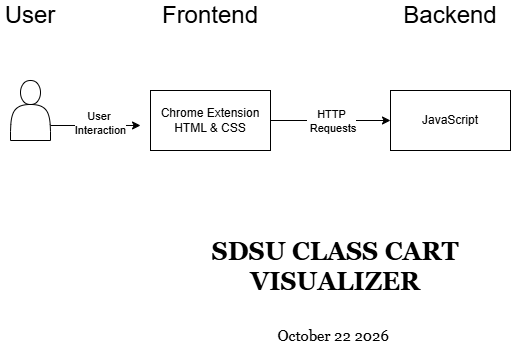

# Role Assignments

| Role | Owns | Specific task | Name |
|---|---|---|---|
| Product Analyst | Part 1 and the questions in Part 4 | Runs the app, picks the user action, writes the purpose sentence, and collects the team’s three questions for the original team. | Carissa Chen |
| Architect | Part 2 and the mismatches in Part 4 | Draws the as-built diagram from the code, then compares it to the handoff UML and records every mismatch. | Mehla Abebe |
| Frontend Tracer | Part 3, client side | Traces the action from the button click to the request leaving the client. Every row gets a file path. | Zachary Soriano |
| Backend Tracer | Part 3, server side | Traces from the API route to the database and back to the response. Every row gets a file path. | Julian Saquic |

# Part 1: Purpose

- This system lets SDSU students with classes in their shopping cart see each class’s professor and jump straight to that professor’s Rate my Professors page so that they can compare instructors and pick sections without searching for each one by hand.
- Users Action we will trace: View a professor’s Rate My Professors link from the shopping cart. The student opens their SDSU class shopping cart, clicks the extension icon, and the popup lists each class with a link to the matching professor’s Rate My Professors profile, or a search page if no exact match is found.

# Part 2: As Built Architecture

# Part 3: Trace Table

| Step | Layer | File and function | Data in / data out | Notes or surprises |
|---|---|---|---|---|
| 1 | Frontend | `popup.js` → `chrome.tabs.query()` | Cart fields → calls `encodeURIComponent(professorName)` | |
| 1 | Frontend | `popup.js` → `showSearchLink()` | Course div, status, professor name → appends URL link | |
| 2 | Frontend | `content.js` → `getShoppingCartClasses()` | `CourseElements` → sends list of course elements to `findRateMyProfessor(instructor)` | |
| 3 | Backend logic | `background.js` → function `findMatchingProfessor()` | `sdsuProfessorName` → inserts into potential names and returns a match | |
| 4 | Database | `background.js` → function `buildSearchUrl()` | Instructor → makes a URL that is the professor’s Rate My Professors page | |
| 5 | API route | `background.js` → `await fetch(searchUrl)` | `searchUrl` → GET request | |
| 6 | Response back | `background.js` → `findMatchingProfessor()` | Takes URL and name → makes a log of what is found | |

# Part 4: Reality Check

1. The handoff states it has no backend, but it does have a backend that is condensed into one file
2. The handoff document’s architecture shows the connection between a few files rather than
between different systems so it is difficult to display how our architecture diagram is different

# Part 5: Candidate Requirements

TODO
| ID | Candidate requirement | Type | Source | Status | Acceptance criterion |
|---|---|---|---|---|---|
|CR-1|The system shall convert instructor names formatted as "Last, First" into "First Last".|Functional|`background.js` → `cleanInstructorName()`|Confirmed|Input "Smith, John" returns "John Smith"|
|CR-2|---|---|---|---|---|
|CR-3|---|---|---|---|---|
|CR-4|---|---|---|---|---|
|CR-5|---|---|---|---|---|

# Part 6: Three Unit Test Cases
TODO
| ID | Requirement | Kind | Input | Expected output | Predicted result today |
|---|---|---|---|---|---|
|---|---|---|---|---|---|
|---|---|---|---|---|---|
|---|---|---|---|---|---|
